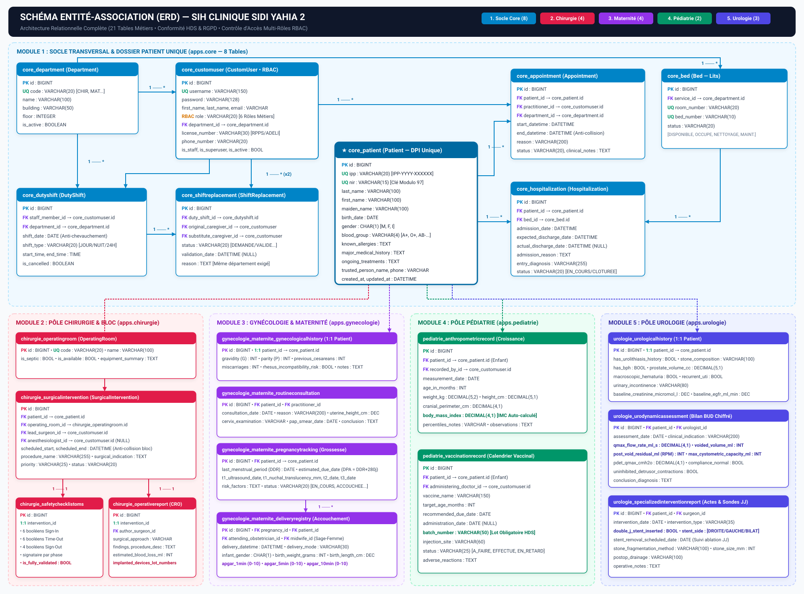

# Schéma et Structure de la Base de Données — SIH Clinique Sidi Yahia 2

Ce document décrit l'architecture relationnelle complète de la base de données du **Système d'Information Hospitalier (SIH)**, conçue selon les normes **HDS (Hébergeur de Données de Santé)** et **RGPD**.

---

## 1. Architecture Globale (21 Tables Métiers en 5 Pôles)

Toutes les tables métiers héritent du modèle abstrait `AuditableModel` qui ajoute automatiquement deux colonnes de traçabilité horodatées à chaque table :
- `created_at` (`DATETIME`, non modifiable) : Date et heure de création de l'enregistrement.
- `updated_at` (`DATETIME`, auto-incrémenté) : Date et heure de dernière modification.

L'architecture est centrée autour de **3 entités pivots** du socle transversal (`apps.core`) :
1. **`Patient` (`core_patient`)** : Dossier Patient Unique (DPI) identifié par son **IPP** (`IPP-YYYY-XXXXXX`) et son **NIR** (15 caractères avec clé modulo 97), partagé par toutes les spécialités.
2. **`CustomUser` (`core_customuser`)** : Personnel hospitalier authentifié avec contrôle d'accès basé sur les **6 rôles RBAC** (`ADMIN`, `CHIRURGIEN`, `MEDECIN`, `SAGE_FEMME`, `INFIRMIER`, `SECRETAIRE`).
3. **`Department` (`core_department`)** : Pôles et services hospitaliers (`CHIR`, `MAT`, `PED`, `URO`, `URG`) auxquels sont rattachés le personnel, les lits et les plannings de garde.

---

## 2. Diagramme Entité-Association Graphique (ERD)

### Vue Graphique Vectorielle Haute Définition (SVG)

### Diagramme Mermaid Interactif

```mermaid
erDiagram
    %% =========================================================
    %% 1. SOCLE TRANSVERSAL (CORE)
    %% =========================================================
    DEPARTMENT ||--o{ CUSTOM_USER : "affecte"
    DEPARTMENT ||--o{ BED : "possede"
    DEPARTMENT ||--o{ APPOINTMENT : "accueille"
    DEPARTMENT ||--o{ DUTY_SHIFT : "planifie"

    CUSTOM_USER ||--o{ APPOINTMENT : "praticien"
    CUSTOM_USER ||--o{ DUTY_SHIFT : "assure"
    CUSTOM_USER ||--o{ SHIFT_replacement : "titulaire / remplacant"

    DUTY_SHIFT ||--o{ SHIFT_replacement : "fait_objet_de"

    PATIENT ||--o{ APPOINTMENT : "prend_rdv"
    PATIENT ||--o{ HOSPITALIZATION : "est_hospitalise"
    BED ||--o{ HOSPITALIZATION : "occupe_lit"

    %% =========================================================
    %% 2. POLE CHIRURGIE & BLOC OPERATOIRE
    %% =========================================================
    PATIENT ||--o{ SURGICAL_INTERVENTION : "subit"
    OPERATING_ROOM ||--o{ SURGICAL_INTERVENTION : "salle_bloc"
    CUSTOM_USER ||--o{ SURGICAL_INTERVENTION : "chirurgien / anesthesiste"
    SURGICAL_INTERVENTION ||--|| SAFETY_CHECKLIST_OMS : "verifie_1_1"
    SURGICAL_INTERVENTION ||--|| OPERATIVE_REPORT : "compte_rendu_1_1"
    CUSTOM_USER ||--o{ OPERATIVE_REPORT : "redige_par"

    %% =========================================================
    %% 3. POLE GYNECOLOGIE & MATERNITE
    %% =========================================================
    PATIENT ||--|| GYNECOLOGICAL_HISTORY : "antecedents_1_1"
    PATIENT ||--o{ ROUTINE_CONSULTATION : "consulte"
    CUSTOM_USER ||--o{ ROUTINE_CONSULTATION : "examine"
    PATIENT ||--o{ PREGNANCY_TRACKING : "grossesse"
    PREGNANCY_TRACKING ||--o{ DELIVERY_REGISTRY : "aboutit_a"
    PATIENT ||--o{ DELIVERY_REGISTRY : "accouche"
    CUSTOM_USER ||--o{ DELIVERY_REGISTRY : "obstetricien / sage_femme"

    %% =========================================================
    %% 4. POLE PEDIATRIE
    %% =========================================================
    PATIENT ||--o{ ANTHROPOMETRIC_RECORD : "croissance"
    CUSTOM_USER ||--o{ ANTHROPOMETRIC_RECORD : "mesure_par"
    PATIENT ||--o{ VACCINATION_RECORD : "calendrier_vaccinal"
    CUSTOM_USER ||--o{ VACCINATION_RECORD : "injecte_par"

    %% =========================================================
    %% 5. POLE UROLOGIE & NEPHROLOGIE
    %% =========================================================
    PATIENT ||--|| UROLOGICAL_HISTORY : "historique_uro_1_1"
    PATIENT ||--o{ URODYNAMIC_ASSESSMENT : "bilan_bud"
    CUSTOM_USER ||--o{ URODYNAMIC_ASSESSMENT : "urologue"
    PATIENT ||--o{ SPECIALIZED_INTERVENTION_REPORT : "acte_uro"
    CUSTOM_USER ||--o{ SPECIALIZED_INTERVENTION_REPORT : "chirurgien_uro"
```

---

## 3. Détail des Tables par Module

### Module 1 : Socle Transversal (`apps.core`) — 8 Tables

#### 1.1 Table `core_department` (`Department`)
Représente les pôles et services de la clinique.

| Colonne | Type SQL | Contraintes | Description |
| :--- | :--- | :--- | :--- |
| `id` | `BIGINT` | `PK, AUTO_INCREMENT` | Identifiant unique du service |
| `code` | `VARCHAR(20)` | `UNIQUE, NOT NULL` | Code court (`CHIR`, `MAT`, `PED`, `URO`, `URG`) |
| `name` | `VARCHAR(100)` | `NOT NULL` | Nom complet du département |
| `building` | `VARCHAR(50)` | `BLANK` | Bâtiment / Aile |
| `floor` | `INTEGER` | `DEFAULT 0` | Étage |
| `is_active` | `BOOLEAN` | `DEFAULT TRUE` | Service actif |
| `created_at` / `updated_at` | `DATETIME` | `NOT NULL` | Horodatage d'audit HDS |

#### 1.2 Table `core_customuser` (`CustomUser`)
Personnel médical, paramédical et administratif (hérite de `AbstractUser` de Django).

| Colonne | Type SQL | Contraintes | Description |
| :--- | :--- | :--- | :--- |
| `id` | `BIGINT` | `PK, AUTO_INCREMENT` | Identifiant unique utilisateur |
| `username` | `VARCHAR(150)` | `UNIQUE, NOT NULL` | Identifiant de connexion |
| `password` | `VARCHAR(128)` | `NOT NULL` | Mot de passe haché (PBKDF2) |
| `first_name` / `last_name` | `VARCHAR(150)` | `BLANK` | Prénom et Nom du professionnel |
| `email` | `VARCHAR(254)` | `BLANK` | Adresse courriel professionnelle |
| `role` | `VARCHAR(20)` | `NOT NULL` | Rôle RBAC : `ADMIN`, `MEDECIN`, `CHIRURGIEN`, `INFIRMIER`, `SAGE_FEMME`, `SECRETAIRE` |
| `department_id` | `BIGINT` | `FK -> core_department(id), NULL` | Service hospitalier d'affectation (`PROTECT`) |
| `license_number` | `VARCHAR(30)` | `BLANK` | Numéro national RPPS / ADELI |
| `phone_number` | `VARCHAR(20)` | `BLANK` | Téléphone d'urgence / Bip |
| `is_staff` / `is_active` / `is_superuser` | `BOOLEAN` | `NOT NULL` | Drapeaux d'accès au portail et administration |

#### 1.3 Table `core_patient` (`Patient` — DPI Unique)
Dossier Patient Informatisé (DPI) central partagé entre tous les services.

| Colonne | Type SQL | Contraintes | Description |
| :--- | :--- | :--- | :--- |
| `id` | `BIGINT` | `PK, AUTO_INCREMENT` | Identifiant interne |
| `ipp` | `VARCHAR(20)` | `UNIQUE, NOT NULL` | Identifiant Permanent Patient auto-généré (`IPP-YYYY-XXXXXX`) |
| `nir` | `VARCHAR(15)` | `UNIQUE, NOT NULL` | Numéro de Sécurité Sociale (validé par clé modulo 97) |
| `last_name` / `first_name` | `VARCHAR(100)` | `NOT NULL` | Nom usuel et Prénom |
| `maiden_name` | `VARCHAR(100)` | `BLANK` | Nom de naissance |
| `birth_date` | `DATE` | `NOT NULL` | Date de naissance |
| `gender` | `VARCHAR(1)` | `NOT NULL` | Sexe biologique (`M`, `F`, `I`) |
| `blood_group` | `VARCHAR(4)` | `DEFAULT 'IND'` | Groupe sanguin (`A+`, `A-`, `B+`, `B-`, `AB+`, `AB-`, `O+`, `O-`, `IND`) |
| `known_allergies` | `TEXT` | `BLANK` | Allergies documentées |
| `major_medical_history` | `TEXT` | `BLANK` | Antécédents médico-chirurgicaux majeurs |
| `ongoing_treatments` | `TEXT` | `BLANK` | Traitements en cours |
| `trusted_person_name` / `phone` | `VARCHAR` | `BLANK` | Personne de confiance et téléphone |
| `phone` / `email` | `VARCHAR` | `BLANK` | Coordonnées du patient |
| `created_at` / `updated_at` | `DATETIME` | `NOT NULL` | Horodatage d'audit HDS |

#### 1.4 Table `core_appointment` (`Appointment`)
Rendez-vous médicaux avec validateur anti-collision d'agenda par praticien.

| Colonne | Type SQL | Contraintes | Description |
| :--- | :--- | :--- | :--- |
| `id` | `BIGINT` | `PK, AUTO_INCREMENT` | Identifiant du RDV |
| `patient_id` | `BIGINT` | `FK -> core_patient(id)` | Patient concerné (`CASCADE`) |
| `practitioner_id` | `BIGINT` | `FK -> core_customuser(id)` | Médecin / Praticien (`PROTECT`) |
| `department_id` | `BIGINT` | `FK -> core_department(id)` | Département de consultation (`PROTECT`) |
| `start_datetime` | `DATETIME` | `NOT NULL` | Date et heure de début |
| `end_datetime` | `DATETIME` | `NOT NULL` | Date et heure de fin (`> start_datetime`, sans chevauchement) |
| `reason` | `VARCHAR(200)` | `NOT NULL` | Motif de la consultation |
| `status` | `VARCHAR(20)` | `DEFAULT 'PLANIFIE'` | `PLANIFIE`, `CONFIRME`, `EN_COURS`, `HONORE`, `ANNULE`, `ABSENT` |
| `clinical_notes` | `TEXT` | `BLANK` | Notes cliniques post-consultation |

#### 1.5 Table `core_bed` (`Bed`)
Lits physiques rattachés aux chambres et départements.

| Colonne | Type SQL | Contraintes | Description |
| :--- | :--- | :--- | :--- |
| `id` | `BIGINT` | `PK, AUTO_INCREMENT` | Identifiant du lit |
| `service_id` | `BIGINT` | `FK -> core_department(id)` | Département de rattachement (`PROTECT`) |
| `room_number` | `VARCHAR(20)` | `NOT NULL` | Numéro de chambre (ex: `101`) |
| `bed_number` | `VARCHAR(10)` | `DEFAULT '1'` | Numéro du lit dans la chambre |
| `status` | `VARCHAR(20)` | `DEFAULT 'DISPONIBLE'` | `DISPONIBLE`, `OCCUPE`, `NETTOYAGE`, `MAINTENANCE` |
| *Contrainte d'unicité* | `UNIQUE` | `(service_id, room_number, bed_number)` | Empêche les doublons de lits |

#### 1.6 Table `core_hospitalization` (`Hospitalization`)
Séjours hospitaliers pilotant automatiquement le statut du lit (`OCCUPE` à l'entrée $\rightarrow$ `NETTOYAGE` à la sortie réelle).

| Colonne | Type SQL | Contraintes | Description |
| :--- | :--- | :--- | :--- |
| `id` | `BIGINT` | `PK, AUTO_INCREMENT` | Identifiant du séjour |
| `patient_id` | `BIGINT` | `FK -> core_patient(id)` | Patient hospitalisé (`CASCADE`) |
| `bed_id` | `BIGINT` | `FK -> core_bed(id)` | Lit affecté (`PROTECT`) |
| `admission_date` | `DATETIME` | `NOT NULL` | Date et heure d'admission |
| `expected_discharge_date` | `DATETIME` | `NOT NULL` | Date prévisionnelle de sortie |
| `actual_discharge_date` | `DATETIME` | `NULL, BLANK` | Date réelle de sortie (déclenche `Bed.status = NETTOYAGE`) |
| `admission_reason` | `TEXT` | `NOT NULL` | Motif d'hospitalisation |
| `entry_diagnosis` | `VARCHAR(255)` | `NOT NULL` | Diagnostic principal d'entrée |
| `status` | `VARCHAR(20)` | `DEFAULT 'EN_COURS'` | `EN_COURS`, `CLOTUREE`, `TRANSFEREE` |

#### 1.7 Table `core_dutyshift` (`DutyShift`)
Planification des gardes et astreintes avec détection des chevauchements horaires (y compris gardes de nuit franchissant minuit).

| Colonne | Type SQL | Contraintes | Description |
| :--- | :--- | :--- | :--- |
| `id` | `BIGINT` | `PK, AUTO_INCREMENT` | Identifiant de la garde |
| `staff_member_id` | `BIGINT` | `FK -> core_customuser(id)` | Soignant planifié (`CASCADE`) |
| `department_id` | `BIGINT` | `FK -> core_department(id)` | Service de garde (`PROTECT`) |
| `shift_date` | `DATE` | `NOT NULL` | Date de début de la garde |
| `shift_type` | `VARCHAR(20)` | `DEFAULT 'JOUR'` | `JOUR` (08h-18h), `NUIT` (18h-08h), `ASTREINTE`, `GARDE_24H` |
| `start_time` / `end_time` | `TIME` | `NOT NULL` | Heures de début et de fin |
| `is_cancelled` | `BOOLEAN` | `DEFAULT FALSE` | Indique si le shift est annulé |

#### 1.8 Table `core_shiftreplacement` (`ShiftReplacement`)
Permutations et remplacements de gardes avec verrouillage strict du département (`substitute_caregiver.department == duty_shift.department`).

| Colonne | Type SQL | Contraintes | Description |
| :--- | :--- | :--- | :--- |
| `id` | `BIGINT` | `PK, AUTO_INCREMENT` | Identifiant de la demande |
| `duty_shift_id` | `BIGINT` | `FK -> core_dutyshift(id)` | Garde à remplacer (`CASCADE`) |
| `original_caregiver_id` | `BIGINT` | `FK -> core_customuser(id)` | Soignant titulaire (`PROTECT`) |
| `substitute_caregiver_id` | `BIGINT` | `FK -> core_customuser(id)` | Soignant remplaçant du même département (`PROTECT`) |
| `status` | `VARCHAR(20)` | `DEFAULT 'DEMANDE'` | `DEMANDE`, `VALIDE`, `REFUSE`, `ANNULE` |
| `validation_date` | `DATETIME` | `NULL, BLANK` | Date de validation par le chef de service |
| `reason` | `TEXT` | `NOT NULL` | Motif du remplacement |

---

### Module 2 : Pôle Chirurgie & Bloc Opératoire (`apps.chirurgie`) — 4 Tables

#### 2.1 Table `chirurgie_operatingroom` (`OperatingRoom`)
| Colonne | Type SQL | Contraintes | Description |
| :--- | :--- | :--- | :--- |
| `id` | `BIGINT` | `PK, AUTO_INCREMENT` | Identifiant de la salle |
| `code` | `VARCHAR(20)` | `UNIQUE, NOT NULL` | Code salle (ex: `BLOC-1`) |
| `name` | `VARCHAR(100)` | `NOT NULL` | Désignation de la salle |
| `is_septic` | `BOOLEAN` | `DEFAULT FALSE` | Salle dédiée septique |
| `is_available` | `BOOLEAN` | `DEFAULT TRUE` | Opérationnelle |
| `equipment_summary` | `TEXT` | `BLANK` | Équipements intégrés (Colonne 4K, Laser, etc.) |

#### 2.2 Table `chirurgie_surgicalintervention` (`SurgicalIntervention`)
| Colonne | Type SQL | Contraintes | Description |
| :--- | :--- | :--- | :--- |
| `id` | `BIGINT` | `PK, AUTO_INCREMENT` | Identifiant de l'intervention |
| `patient_id` | `BIGINT` | `FK -> core_patient(id)` | Patient opéré (`CASCADE`) |
| `operating_room_id` | `BIGINT` | `FK -> chirurgie_operatingroom(id)` | Salle d'opération (`PROTECT`, anti-collision horaire) |
| `lead_surgeon_id` | `BIGINT` | `FK -> core_customuser(id)` | Chirurgien principal (`PROTECT`) |
| `anesthesiologist_id` | `BIGINT` | `FK -> core_customuser(id), NULL` | Médecin Anesthésiste-Réanimateur (`PROTECT`) |
| `scheduled_start` / `end` | `DATETIME` | `NOT NULL` | Créneau opératoire prévu |
| `procedure_name` | `VARCHAR(255)` | `NOT NULL` | Intitulé de l'acte chirurgical |
| `surgical_indication` | `TEXT` | `NOT NULL` | Indication opératoire |
| `priority` | `VARCHAR(25)` | `DEFAULT 'PROGRAMMEE'` | `PROGRAMMEE`, `URGENCE_RELATIVE`, `URGENCE_VITALE` |
| `status` | `VARCHAR(20)` | `DEFAULT 'PLANIFIEE'` | `PLANIFIEE`, `EN_SALLE`, `EN_COURS`, `TERMINEE`, `ANNULEE` |

#### 2.3 Table `chirurgie_safetychecklistoms` (`SafetyChecklistOMS`)
Relation `1:1` avec `SurgicalIntervention`. Regroupe les 16 points de contrôle normés OMS / HAS répartis en 3 phases :
- **Phase 1 (`SIGN-IN`)** : `signin_patient_identity_confirmed`, `signin_site_marked`, `signin_consent_verified`, `signin_allergy_risk_checked`, `signin_airway_risk_evaluated`, `signin_bleeding_risk_evaluated`, `signin_completed_by`.
- **Phase 2 (`TIME-OUT`)** : `timeout_team_introduced`, `timeout_reconfirmation_procedure`, `timeout_antibiotic_prophylaxis`, `timeout_critical_steps_reviewed`, `timeout_sterility_confirmed`, `timeout_imaging_displayed`, `timeout_completed_by`.
- **Phase 3 (`SIGN-OUT`)** : `signout_procedure_confirmed`, `signout_instrument_count_correct`, `signout_specimen_labeled`, `signout_postop_plan_reviewed`, `signout_completed_by`.
- **`is_fully_validated`** (`BOOLEAN`) : Calculé automatiquement à `TRUE` uniquement si les 16 contrôles sont validés.

#### 2.4 Table `chirurgie_operativereport` (`OperativeReport` — CRO)
Relation `1:1` avec `SurgicalIntervention`. Contient : `author_surgeon_id` (`FK -> core_customuser`), `report_date`, `surgical_approach`, `findings`, `procedure_description`, `estimated_blood_loss_ml`, `implanted_devices_lot_numbers` (matériovigilance HDS), `intraoperative_complications`, `postoperative_instructions`.

---

### Module 3 : Pôle Gynécologie & Maternité (`apps.gynecologie_maternite`) — 4 Tables

| Table SQL | Modèle Django | Clés Étrangères (FK / 1:1) | Colonnes Principales & Règles Métiers |
| :--- | :--- | :--- | :--- |
| `gynecologie_maternite_gynecologicalhistory` | `GynecologicalHistory` | `patient_id` (`1:1 -> core_patient`) | `gravidity` (Gestité G), `parity` (Parité P), `previous_cesareans`, `miscarriages`, `rhesus_incompatibility_risk`, `gynecological_surgeries`, `notes` |
| `gynecologie_maternite_routineconsultation` | `RoutineConsultation` | `patient_id` (`FK -> core_patient`), `practitioner_id` (`FK -> core_customuser`) | `consultation_date`, `reason`, `uterine_height_cm`, `cervix_examination`, `pap_smear_date`, `ultrasound_summary`, `conclusion_and_treatment` |
| `gynecologie_maternite_pregnancytracking` | `PregnancyTracking` | `patient_id` (`FK -> core_patient`) | `last_menstrual_period` (DDR), `estimated_due_date` (DPA auto-calculée à `DDR + 280 jours`), `risk_factors`, dates d'échographies `t1`, `t2`, `t3`, `t1_nuchal_translucency_mm`, `status` (`EN_COURS`, `ACCOUCHEE`, `INTERROMPUE`) |
| `gynecologie_maternite_deliveryregistry` | `DeliveryRegistry` | `pregnancy_id` (`FK -> PregnancyTracking`), `patient_id` (`FK -> core_patient`), `attending_obstetrician_id`, `midwife_id` | `delivery_datetime`, `delivery_mode` (`VOIE_BASSE_SPONTANEE`, `VENTOUSE`, `FORCEPS`, `CESARIENNE_PROGRAMMEE`, `CESARIENNE_URGENCE`), `infant_gender`, `birth_weight_grams`, `birth_length_cm`, `cranial_perimeter_cm`, `apgar_1min`, `apgar_5min`, `apgar_10min` (validés entre 0 et 10 ; clôture automatiquement `PregnancyTracking` à `ACCOUCHEE`) |

---

### Module 4 : Pôle Pédiatrie (`apps.pediatrie`) — 2 Tables

| Table SQL | Modèle Django | Clés Étrangères (FK) | Colonnes Principales & Règles Métiers |
| :--- | :--- | :--- | :--- |
| `pediatrie_anthropometricrecord` | `AnthropometricRecord` | `patient_id` (`FK -> core_patient`), `recorded_by_id` (`FK -> core_customuser`) | `measurement_date`, `age_in_months`, `weight_kg`, `height_cm`, `cranial_perimeter_cm`, `body_mass_index` (IMC calculé automatiquement : $\text{Poids} / \text{Taille(m)}^2$), `percentiles_notes`, `clinical_observations` |
| `pediatrie_vaccinationrecord` | `VaccinationRecord` | `patient_id` (`FK -> core_patient`), `administering_doctor_id` (`FK -> core_customuser`) | `vaccine_name`, `target_age_months`, `recommended_due_date`, `administration_date`, `batch_number` (numéro de lot **obligatoire** si administré), `injection_site`, `status` (`A_FAIRE`, `EFFECTUE`, `EN_RETARD`, `CONTRE_INDIQUE`), `adverse_reactions` |

---

### Module 5 : Pôle Urologie & Néphrologie (`apps.urologie`) — 3 Tables

| Table SQL | Modèle Django | Clés Étrangères (FK / 1:1) | Colonnes Principales & Règles Métiers |
| :--- | :--- | :--- | :--- |
| `urologie_urologicalhistory` | `UrologicalHistory` | `patient_id` (`1:1 -> core_patient`) | `has_urolithiasis_history`, `stone_composition`, `has_bph`, `prostate_volume_cc`, `macroscopic_hematuria`, `urinary_incontinence`, `recurrent_uti`, `baseline_creatinine_micromol_l`, `baseline_egfr_ml_min` |
| `urologie_urodynamicassessment` | `UrodynamicAssessment` | `patient_id` (`FK -> core_patient`), `urologist_id` (`FK -> core_customuser`) | `assessment_date`, `clinical_indication`, `qmax_flow_rate_ml_s` (Qmax), `voided_volume_ml`, `post_void_residual_ml` (RPM), `maximum_cystometric_capacity_ml` (CVM), `pdet_qmax_cmh2o`, `uninhibited_detrusor_contractions`, `compliance_normal`, `conclusion_diagnosis` |
| `urologie_specializedinterventionreport` | `SpecializedInterventionReport` | `patient_id` (`FK -> core_patient`), `surgeon_id` (`FK -> core_customuser`) | `intervention_date`, `intervention_type` (`CYSTOSCOPIE`, `URETEROSCOPIE_SOUPLE`, `LITHOTRIPSIE`, `RESECTION_PROSTATE`, `NEPHRECTOMIE`, `AUTRE`), `double_j_stent_inserted`, `stent_side` (`DROITE`, `GAUCHE`, `BILATERAL` — obligatoire si sonde JJ posée), `stent_removal_scheduled_date`, `stone_fragmentation_method`, `stone_size_mm`, `postop_drainage`, `operative_notes` |

