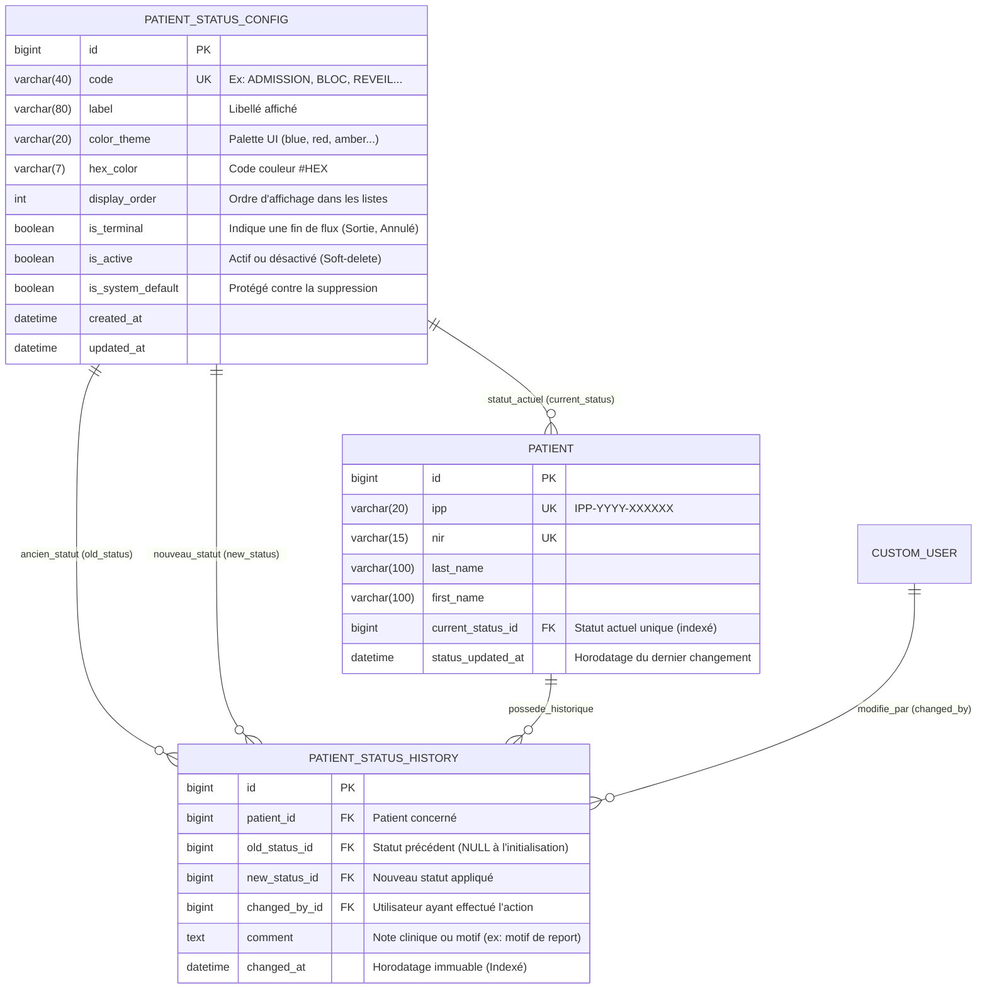

# Spécification Fonctionnelle et Technique (SFT)
## Gestion Dynamique du Parcours et des Statuts des Patients Post-Admission

- **Projet** : Système d'Information Hospitalier (SIH) — Clinique Sidi Yahia 2
- **Module cible** : Socle Transversal (`apps.core`) & Portail Clinique Temps Réel
- **Conformité réglementaire** : HDS (Hébergeur de Données de Santé) / RGPD (Traçabilité immuable des actes et mouvements)
- **Statut du document** : Spécification Architecture & Produit (Prête pour implémentation)

---

## 1. Vision Produit & Objectifs Métiers

Dans un établissement médico-chirurgical, la visibilité en temps réel sur la localisation et l'étape du parcours de soin de chaque patient admis est critique pour la coordination entre l'accueil, les unités d'hospitalisation (Services), le Bloc opératoire et la Salle de Surveillance Post-Interventionnelle (SSPI / Réveil).

### Objectifs clés :
1. **Paramétrabilité sans redéploiement** : Permettre aux Administrateurs (`ADMIN`) de créer, modifier, ordonner ou désactiver des statuts de parcours patient via une table de paramétrage général, sans modifier le code source.
2. **Traçabilité Médico-Légale (Audit Trail HDS)** : Enregistrer automatiquement chaque transition de statut (horodatage exact, statut d'origine, nouveau statut, auteur authentifié et motif éventuel) dans un journal d'audit non altérable.
3. **Conscience Situationnelle Immédiate (UI/UX)** : Offrir aux équipes soignantes une vue synthétique (badges chromatiques normés) et un filtrage multicritère instantané combinant statut actuel et recherche identitaire (`Nom`, `Prénom`, `IPP`).

---

## 2. Modèle de Données (Architecture Relationnelle SQL & ORM Django)

### 2.1 Diagramme Entité-Relation (ERD) du Sous-Système de Statuts



---

### 2.2 Structure SQL Détaillée (PostgreSQL / SQLite)

#### A. Table de Paramétrage Général : `core_patientstatusconfig`
Stocke le référentiel dynamique des statuts configurables par les administrateurs.

```sql
CREATE TABLE core_patientstatusconfig (
    id BIGSERIAL PRIMARY KEY,
    code VARCHAR(40) NOT NULL UNIQUE,           -- Clé technique normalisée (ex: 'BLOC')
    label VARCHAR(80) NOT NULL,                 -- Libellé métier (ex: 'Bloc')
    description VARCHAR(255) DEFAULT '',        -- Description fonctionnelle de l'étape
    color_theme VARCHAR(20) NOT NULL DEFAULT 'slate', -- Thème CSS/Tailwind (sky, rose, amber, emerald...)
    hex_color VARCHAR(7) NOT NULL DEFAULT '#64748B',  -- Code hexadécimal exact pour exports/graphiques
    display_order INTEGER NOT NULL DEFAULT 10,  -- Ordre logique dans le parcours patient
    is_terminal BOOLEAN NOT NULL DEFAULT FALSE, -- Vrai pour 'Sortie', 'Annulé'
    is_active BOOLEAN NOT NULL DEFAULT TRUE,    -- Permet de désactiver sans casser l'historique (FK)
    is_system_default BOOLEAN NOT NULL DEFAULT FALSE, -- Statut natif initial
    created_at TIMESTAMP WITH TIME ZONE NOT NULL DEFAULT NOW(),
    updated_at TIMESTAMP WITH TIME ZONE NOT NULL DEFAULT NOW()
);

CREATE INDEX idx_statusconfig_active_order ON core_patientstatusconfig (is_active, display_order);
```

#### B. Extension de la Table Patient : `core_patient`
Ajout d'une clé étrangère indexée `current_status_id` dénormalisant l'état courant pour garantir des performances de filtrage en $O(1)$ sur la liste des patients sans sous-requête coûteuse sur l'historique.

```sql
ALTER TABLE core_patient
ADD COLUMN current_status_id BIGINT NULL
    REFERENCES core_patientstatusconfig(id) ON DELETE RESTRICT,
ADD COLUMN status_updated_at TIMESTAMP WITH TIME ZONE NULL;

CREATE INDEX idx_patient_current_status ON core_patient (current_status_id);
CREATE INDEX idx_patient_search_composite ON core_patient (current_status_id, last_name, first_name, ipp);
```

#### C. Table d'Historique et d'Audit : `core_patientstatushistory`
Table **Append-Only** (insertion uniquement, aucune modification ni suppression autorisée) garantissant l'intégrité médico-légale HDS.

```sql
CREATE TABLE core_patientstatushistory (
    id BIGSERIAL PRIMARY KEY,
    patient_id BIGINT NOT NULL
        REFERENCES core_patient(id) ON DELETE CASCADE,
    old_status_id BIGINT NULL
        REFERENCES core_patientstatusconfig(id) ON DELETE RESTRICT,
    new_status_id BIGINT NOT NULL
        REFERENCES core_patientstatusconfig(id) ON DELETE RESTRICT,
    changed_by_id BIGINT NOT NULL
        REFERENCES core_customuser(id) ON DELETE PROTECT,
    comment TEXT DEFAULT '',
    changed_at TIMESTAMP WITH TIME ZONE NOT NULL DEFAULT NOW()
);

CREATE INDEX idx_statushistory_patient_date ON core_patientstatushistory (patient_id, changed_at DESC);
```

---

### 2.3 Référentiel des 7 Statuts Initiaux par Défaut (Seed Data)

Lors de l'initialisation (`migrate` / `seed_hospital_data`), les 7 statuts réglementaires suivants sont pré-configurés :

| Ordre | Code Technique | Libellé (`label`) | Couleur UI (`color_theme`) | Code `#HEX` | Terminal | Signification Clinique |
| :---: | :--- | :--- | :--- | :---: | :---: | :--- |
| **1** | `ADMISSION` | **Admission** | Bleu Ciel (`sky`) | `#0284C7` | Non | Patient enregistré à l'accueil / en préparation pré-hospitalière |
| **2** | `SERVICE` | **Service** | Indigo (`indigo`) | `#4F46E5` | Non | Patient installé en chambre dans son unité d'hospitalisation |
| **3** | `BLOC` | **Bloc** | Rouge Corail (`rose`) | `#E11D48` | Non | Patient actuellement en salle d'intervention au bloc opératoire |
| **4** | `REVEIL` | **Réveil** | Ambre / Orange (`amber`) | `#D97706` | Non | Patient en SSPI (Salle de Surveillance Post-Interventionnelle) |
| **5** | `REPORTE` | **Reporté** | Violet (`purple`) | `#9333EA` | Non | Acte ou prise en charge reportée à une date ultérieure |
| **6** | `SORTIE` | **Sortie** | Vert Émeraude (`emerald`) | `#059669` | Oui | Patient ayant quitté l'établissement après validation médicale |
| **7** | `ANNULE` | **Annulé** | Gris Ardoise (`slate`) | `#64748B` | Oui | Admission ou venue annulée avant prise en charge |

---

### 2.4 Implémentation ORM Django (`apps/core/models.py`)

```python
class PatientStatusColor(models.TextChoices):
    SKY = "sky", "Bleu Ciel (Admission / Accueil)"
    INDIGO = "indigo", "Indigo (Service / Unité de soin)"
    ROSE = "rose", "Rouge Corail (Bloc Opératoire / Urgence)"
    AMBER = "amber", "Ambre / Orange (Réveil / Surveillance SSPI)"
    EMERALD = "emerald", "Vert Émeraude (Sortie / Validé)"
    PURPLE = "purple", "Violet (Reporté / En attente)"
    SLATE = "slate", "Gris Ardoise (Annulé / Clôturé)"


class PatientStatusConfig(AuditableModel):
    """Référentiel dynamique des statuts de parcours patient (Paramétrage Général)."""

    code = models.CharField(max_length=40, unique=True, verbose_name="Code technique")
    label = models.CharField(max_length=80, verbose_name="Libellé du statut")
    description = models.CharField(max_length=255, blank=True, verbose_name="Description")
    color_theme = models.CharField(
        max_length=20,
        choices=PatientStatusColor.choices,
        default=PatientStatusColor.SKY,
        verbose_name="Couleur du badge",
    )
    hex_color = models.CharField(max_length=7, default="#0284C7", verbose_name="Code HEX")
    display_order = models.PositiveIntegerField(default=10, verbose_name="Ordre d'affichage")
    is_terminal = models.BooleanField(default=False, verbose_name="Statut de fin de parcours")
    is_active = models.BooleanField(default=True, verbose_name="Statut actif")
    is_system_default = models.BooleanField(default=False, verbose_name="Statut système natif")

    class Meta:
        verbose_name = "Configuration de Statut Patient"
        verbose_name_plural = "Configurations des Statuts Patients"
        ordering = ["display_order", "label"]

    def __str__(self) -> str:
        return f"{self.label} ({self.code})"


class PatientStatusHistory(models.Model):
    """Journal d'audit immuable (HDS) de tous les changements de statut d'un patient."""

    patient = models.ForeignKey(
        "Patient",
        on_delete=models.CASCADE,
        related_name="status_history",
        verbose_name="Patient",
    )
    old_status = models.ForeignKey(
        PatientStatusConfig,
        on_delete=models.PROTECT,
        null=True,
        blank=True,
        related_name="transitions_from",
        verbose_name="Ancien statut",
    )
    new_status = models.ForeignKey(
        PatientStatusConfig,
        on_delete=models.PROTECT,
        related_name="transitions_to",
        verbose_name="Nouveau statut",
    )
    changed_by = models.ForeignKey(
        "CustomUser",
        on_delete=models.PROTECT,
        related_name="patient_status_changes",
        verbose_name="Modifié par",
    )
    comment = models.TextField(blank=True, verbose_name="Motif / Observation clinique")
    changed_at = models.DateTimeField(auto_now_add=True, db_index=True, verbose_name="Date et heure du changement")

    class Meta:
        verbose_name = "Historique de Statut Patient"
        verbose_name_plural = "Historiques des Statuts Patients"
        ordering = ["-changed_at"]
```

#### Logique transactionnelle de changement de statut (Méthode Métier Atomique) :
```python
@transaction.atomic
def change_patient_status(
    patient: Patient,
    new_status: PatientStatusConfig,
    user: CustomUser,
    comment: str = "",
) -> PatientStatusHistory:
    """
    Met à jour le statut actuel du patient et crée une entrée d'audit immuable
    au sein d'une même transaction atomique.
    """
    if not new_status.is_active:
        raise ValidationError("Impossible d'affecter un statut désactivé.")

    old_status = patient.current_status
    if old_status == new_status:
        raise ValidationError("Le patient possède déjà ce statut actuel.")

    now = timezone.now()
    patient.current_status = new_status
    patient.status_updated_at = now
    patient.save(update_fields=["current_status", "status_updated_at", "updated_at"])

    history_entry = PatientStatusHistory.objects.create(
        patient=patient,
        old_status=old_status,
        new_status=new_status,
        changed_by=user,
        comment=comment,
    )
    return history_entry
```

---

## 3. Logique API & Endpoints REST

Tous les endpoints sont protégés par l'authentification de session/token (`StrictAuthenticationMiddleware` : **aucun accès anonyme**) et le contrôle d'accès basé sur les rôles (`RBAC`).

### 3.1 Matrice des Droits RBAC sur les Endpoints

| Endpoint | Méthode | Action | Rôles Autorisés |
| :--- | :---: | :--- | :--- |
| `/api/v1/status-configs/` | `GET` | Lister les statuts actifs (pour filtres et sélecteurs) | Tous les rôles connectés (`ADMIN`, `CHIRURGIEN`, `MEDECIN`, `SAGE_FEMME`, `INFIRMIER`, `SECRETAIRE`) |
| `/api/v1/status-configs/` | `POST` | Créer un nouveau statut personnalisé | `ADMIN` uniquement |
| `/api/v1/status-configs/{id}/` | `PATCH` | Modifier un statut (libellé, couleur, ordre, `is_active`) | `ADMIN` uniquement |
| `/api/v1/patients/` | `GET` | Lister et filtrer les patients (`?status=...&q=...`) | Tous les rôles connectés |
| `/api/v1/patients/{id}/status/` | `POST` | Changer le statut actuel d'un patient + journaliser | `ADMIN`, `CHIRURGIEN`, `MEDECIN`, `SAGE_FEMME`, `INFIRMIER`, `SECRETAIRE` |
| `/api/v1/patients/{id}/status-history/` | `GET` | Consulter l'historique complet des statuts d'un patient | Tous les rôles connectés |

---

### 3.2 Spécification Détaillée des Endpoints

#### 1. `GET /api/v1/status-configs/` — Liste des statuts configurés
- **Paramètres Query** :
  - `include_inactive=false` (par défaut : renvoie uniquement `is_active=True` triés par `display_order`).
- **Réponse `200 OK`** :
```json
{
  "count": 7,
  "results": [
    {
      "id": 1,
      "code": "ADMISSION",
      "label": "Admission",
      "color_theme": "sky",
      "hex_color": "#0284C7",
      "display_order": 1,
      "is_terminal": false,
      "is_active": true,
      "patients_count": 4
    },
    {
      "id": 3,
      "code": "BLOC",
      "label": "Bloc",
      "color_theme": "rose",
      "hex_color": "#E11D48",
      "display_order": 3,
      "is_terminal": false,
      "is_active": true,
      "patients_count": 2
    }
  ]
}
```

#### 2. `POST /api/v1/status-configs/` & `PATCH /api/v1/status-configs/{id}/` — Paramétrage Admin
- **Payload `POST` (Création d'un statut par un Administrateur)** :
```json
{
  "code": "IMAGERIE",
  "label": "Imagerie / Scanner",
  "description": "Patient en cours d'examen radiologique",
  "color_theme": "indigo",
  "hex_color": "#4F46E5",
  "display_order": 4,
  "is_terminal": false,
  "is_active": true
}
```
- **Règle de désactivation (`PATCH {"is_active": false}`)** :
  - La suppression physique (`DELETE`) d'un statut déjà utilisé dans `PatientStatusHistory` est **interdite** (`ON DELETE RESTRICT`) pour préserver l'historique HDS.
  - L'administrateur utilise `"is_active": false` : le statut n'apparaît plus dans les menus de changement de statut, mais reste lisible dans les historiques passés.

#### 3. `GET /api/v1/patients/` (et Vue Web `/core/patients/`) — Liste, Recherche Globale & Filtre par Statut
- **Paramètres Query combinables** :
  - `q` (`string`, optionnel) : Recherche insensible à la casse sur `last_name`, `first_name`, `maiden_name` ou `ipp`.
  - `status` (`string`, optionnel) : Code(s) ou ID(s) de statut. Supporte la sélection simple (`?status=BLOC`) et la **multi-sélection** (`?status=BLOC,REVEIL`).
  - `page` (`int`, défaut `1`) : Pagination (20 patients par page).
- **Logique de filtrage ORM (Django)** :
```python
queryset = Patient.objects.select_related("current_status").all()

# 1. Filtre par Statut (Simple ou Multi-sélection)
status_param = request.GET.get("status", "").strip()
if status_param:
    status_codes = [s.strip().upper() for s in status_param.split(",") if s.strip()]
    queryset = queryset.filter(current_status__code__in=status_codes)

# 2. Recherche textuelle globale combinée (Nom, Prénom, IPP)
search_query = request.GET.get("q", "").strip()
if search_query:
    queryset = queryset.filter(
        Q(last_name__icontains=search_query)
        | Q(first_name__icontains=search_query)
        | Q(ipp__icontains=search_query)
    )
```

#### 4. `POST /api/v1/patients/{id}/status/` — Mise à jour en temps réel du statut d'un patient
- **Payload Requête** :
```json
{
  "new_status_code": "REVEIL",
  "comment": "Sortie de salle BLOC-1 à 14h20, constantes stables, transfert SSPI."
}
```
- **Réponse `200 OK`** :
```json
{
  "status": "success",
  "patient_id": 12,
  "ipp": "IPP-2026-000001",
  "old_status": {
    "code": "BLOC",
    "label": "Bloc",
    "color_theme": "rose"
  },
  "current_status": {
    "code": "REVEIL",
    "label": "Réveil",
    "color_theme": "amber"
  },
  "updated_at": "2026-10-30T14:20:05Z",
  "updated_by": "Dr Alain Rousseau [Chirurgien]"
}
```
- **Codes d'erreur** :
  - `400 Bad Request` : Statut cible identique au statut actuel ou statut cible inactif (`is_active=False`).
  - `403 Forbidden` : Utilisateur non authentifié ou rôle non autorisé.
  - `404 Not Found` : Patient ou code statut introuvable.

#### 5. `GET /api/v1/patients/{id}/status-history/` — Historique des transitions du patient
- **Réponse `200 OK`** :
```json
{
  "patient_ipp": "IPP-2026-000001",
  "patient_name": "DUBOIS Mathieu",
  "current_status": "REVEIL",
  "history": [
    {
      "id": 45,
      "changed_at": "2026-10-30T14:20:05Z",
      "old_status": {"code": "BLOC", "label": "Bloc", "color_theme": "rose"},
      "new_status": {"code": "REVEIL", "label": "Réveil", "color_theme": "amber"},
      "changed_by": {
        "username": "dr_alain_chir",
        "full_name": "Dr Alain Rousseau",
        "role": "Chirurgien"
      },
      "comment": "Sortie de salle BLOC-1 à 14h20, transfert SSPI."
    },
    {
      "id": 41,
      "changed_at": "2026-10-30T11:45:00Z",
      "old_status": {"code": "SERVICE", "label": "Service", "color_theme": "indigo"},
      "new_status": {"code": "BLOC", "label": "Bloc", "color_theme": "rose"},
      "changed_by": {
        "username": "inf_paul_chir",
        "full_name": "Paul Lefevre",
        "role": "Infirmier(e) D.E."
      },
      "comment": "Brancardage vers Bloc 1."
    }
  ]
}
```

---

## 4. Guide d'Interface Utilisateur (UI / UX)

### 4.1 Charte Graphique des Badges de Statut (Design System Tailwind CSS)

Chaque statut est représenté par un badge en pilule (`rounded-full px-3 py-1 text-xs font-bold border inline-flex items-center gap-1.5`) doté d'une pastille lumineuse pour une reconnaissance visuelle immédiate à distance sur les écrans des postes de soins :

| Statut | Rendu Visuel | Classes Tailwind CSS du Badge | Pastille |
| :--- | :--- | :--- | :--- |
| **Admission** | `● Admission` | `bg-sky-50 text-sky-700 border-sky-200` | `bg-sky-500` |
| **Service** | `● Service` | `bg-indigo-50 text-indigo-700 border-indigo-200` | `bg-indigo-500` |
| **Bloc** | `● Bloc` | `bg-rose-50 text-rose-700 border-rose-200` | `bg-rose-500 animate-pulse` |
| **Réveil** | `● Réveil` | `bg-amber-50 text-amber-800 border-amber-200` | `bg-amber-500 animate-pulse` |
| **Reporté** | `● Reporté` | `bg-purple-50 text-purple-700 border-purple-200` | `bg-purple-500` |
| **Sortie** | `● Sortie` | `bg-emerald-50 text-emerald-700 border-emerald-200` | `bg-emerald-500` |
| **Annulé** | `● Annulé` | `bg-slate-100 text-slate-600 border-slate-300` | `bg-slate-400` |

*(Note UX : Les statuts critiques en cours d'intervention — **Bloc** et **Réveil** — disposent d'une pastille pulsante `animate-pulse` pour attirer l'attention des équipes médicales).*

---

### 4.2 Maquette Fonctionnelle (Wireframe) — Page de Liste des Patients

```text
+----------------------------------------------------------------------------------------------------------+
| SIH Clinique Sidi Yahia 2   |   Suivi des Patients & Parcours Post-Admission     [Paramétrer Statuts ⚙️] |
+----------------------------------------------------------------------------------------------------------+
| COMPTEURS TEMPS RÉEL (Cliquables pour filtrage rapide en 1 clic) :                                       |
| [ Tous (24) ]  [● Admission (4)]  [● Service (9)]  [● Bloc (2)]  [● Réveil (3)]  [● Sortie (5)]          |
+----------------------------------------------------------------------------------------------------------+
| BARRE DE RECHERCHE & FILTRES COMBINÉS :                                                                  |
|  🔍 [ Rechercher par Nom, Prénom ou IPP...          ]   🏷️ Statut : [ Tous les statuts (ou Bloc) ▼ ]     |
|                                                                     [ Filtrer ]  [ Réinitialiser ]       |
+----------------------------------------------------------------------------------------------------------+
| IPP               | PATIENT (NOM / PRÉNOM) | DATE NAISS. | CHAMBRE / LIT | STATUT ACTUEL   | ACTIONS     |
|-------------------|------------------------|-------------|---------------|-----------------|-------------|
| IPP-2026-000001   | DUBOIS Mathieu (M)     | 12/05/1985  | CHIR - Ch.101 | (● Bloc       ) | [Changer ▾] |
|                   |                        |             | Lit 1         | il y a 15 min   | [🕒 Hist.]  |
|-------------------|------------------------|-------------|---------------|-----------------|-------------|
| IPP-2026-000002   | MARTIN Aurélie (F)     | 14/03/1992  | MAT - Ch.101  | (● Service    ) | [Changer ▾] |
|                   |                        |             | Lit 1         | il y a 2h       | [🕒 Hist.]  |
|-------------------|------------------------|-------------|---------------|-----------------|-------------|
| IPP-2026-000003   | BERNARD Christian (M)  | 20/04/1960  | URO - Ch.102  | (● Réveil     ) | [Changer ▾] |
|                   |                        |             | Lit 2         | il y a 30 min   | [🕒 Hist.]  |
+----------------------------------------------------------------------------------------------------------+
```

---

### 4.3 Comportement Interactif (UX)

1. **Double mode de filtrage par statut** :
   - **Pills de compteur rapide en haut de tableau** : Cliquer sur la pastille `[● Bloc (2)]` filtre instantanément la table sur `status=BLOC` tout en conservant le texte éventuellement saisi dans la barre de recherche.
   - **Menu déroulant (Dropdown) `Statut`** : Permet de sélectionner un statut précis (ou `"Tous les statuts"`) combiné au champ de recherche `Nom / Prénom / IPP`.
2. **Changement rapide de statut en ligne (`[Changer ▾]`)** :
   - Cliquer sur `[Changer ▾]` sur la ligne d'un patient ouvre un menu rapide (ou modale légère) proposant uniquement les statuts actifs (`is_active=True`) ainsi qu'un champ optionnel *"Note / Motif"* (obligatoire si le statut choisi est `Reporté` ou `Annulé`).
   - Dès validation, le badge de la colonne **Statut Actuel** se met à jour immédiatement et une ligne est insérée dans `PatientStatusHistory`.
3. **Consultation de l'historique (`[🕒 Hist.]`)** :
   - Ouvre un panneau latéral (ou modale) affichant la frise chronologique (Timeline) complète des statuts du patient :
     - *30/10/2026 14:20* : `Bloc` $\rightarrow$ `Réveil` par **Dr Alain Rousseau** (*Chirurgien*)
     - *30/10/2026 11:45* : `Service` $\rightarrow$ `Bloc` par **Paul Lefevre** (*Infirmier D.E.*)
     - *29/10/2026 09:10* : `Admission` $\rightarrow$ `Service` par **Nadia Benali** (*Secrétaire Médicale*)

