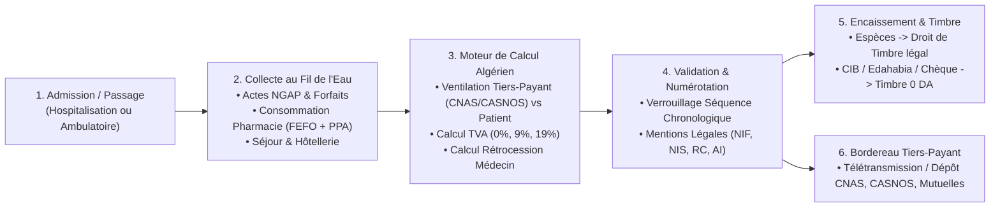
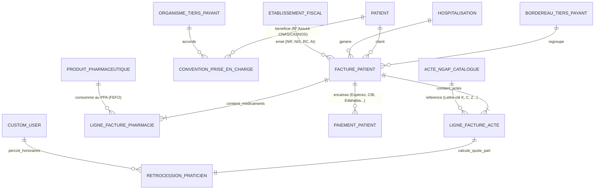

# Spécification d'Architecture Logicielle & Réglementaire — Module de Facturation Hospitalière (Législation Algérienne)

**Établissement cible** : Clinique Médico-Chirurgicale Privée (EHS privé / Clinique Sidi Yahia 2 — Alger) avec prise en charge du mode Établissement Public Hospitalier (EPH / CHU - Bureau des Entrées).  
**Référentiels légaux algériens** :
* **Code des Impôts Directs et Taxes Assimilées (CIDTA)** & **Code des Taxes sur le Chiffre d'Affaires (CTCA)** (Taux de TVA 0 %, 9 %, 19 %).
* **Code du Timbre** (Art. 100 modifié par les Lois de Finances algériennes : Droit de timbre sur espèces et exonération CIB / Edahabia / Chèque / Virement).
* **Décret exécutif n° 05-468** fixant les conditions et les modalités d'établissement de la facture (NIF, NIS, RC, AI, numérotation séquentielle sans rupture).
* **Nomenclature Générale des Actes Professionnels (NGAP - Algérie)** et Conventions **CNAS / CASNOS / Caisses Mutuelles & Assurances**.

---

## 1. Architecture Fonctionnelle Globale

### 1.1 Distinction Clinique Privée vs Établissement Public (EPH/CHU) en Algérie
| Critère Métier | Clinique Privée (ex: Clinique Sidi Yahia 2) | Établissement Public (EPH / CHU) |
| :--- | :--- | :--- |
| **Tarification des actes** | Libre ou Conventionnée CNAS (Forfaits Chirurgie lourde, Cardiologie, Maternité, Hémodialyse) + Dépassements d'honoraires | Tarif national réglementé (Valeur officielle des lettres-clés NGAP : `C`, `K`, `Z`, `B`, `AMI`, `SF`) |
| **Assujettissement TVA** | Exonéré (`0%`) ou Taux réduit (`9%`) sur soins/médicaments ; Taux normal (`19%`) sur hôtellerie VIP / confort | Exonéré de TVA (Service public hospitalier) |
| **Rétrocession Praticiens** | Partage d'honoraires entre la Clinique (Plateau technique) et le Médecin libéral/vacataire | Praticiens salariés de la santé publique (pas de rétrocession à l'acte, sauf activité complémentaire réglementée) |
| **Facturation Médicaments** | Au **PPA (Prix Public Algérien)** avec déstockage FEFO depuis la Pharmacie Centrale | Inclus dans le forfait journalier d'hospitalisation (pris en charge par le budget de l'État / CNAS forfaitaire) |

### 1.2 Flux Fonctionnel de Bout en Bout


---

## 2. Modèle Conceptuel et Logique de Données (MCD / MLD)

### 2.1 Diagramme Entité-Association (MCD / MLD)


### 2.2 Schéma Relationnel Détaillé (MLD — Compatible PostgreSQL & Django ORM)

#### A. `EtablissementFiscal` (Identité Légale & Fiscale Algérienne)
* `id` (PK)
* `raison_sociale` (`VARCHAR(200)`) : ex. `"EURL CLINIQUE SIDI YAHIA 2"`
* `forme_juridique` (`VARCHAR(50)`) : `"EURL"`, `"SPA"`, `"SARL"`, `"EPH"`
* `capital_social_da` (`NUMERIC(14,2)`) : ex. `50000000.00` DA
* `adresse_complete` (`TEXT`) : Adresse officielle en Algérie
* `wilaya` (`VARCHAR(80)`) : ex. `"16 - Alger"`
* `nif` (`VARCHAR(20)`, obligatoire) : **Numéro d'Identification Fiscale** (15 ou 20 chiffres DGI)
* `nis` (`VARCHAR(20)`, obligatoire) : **Numéro d'Identification Statistique** (15 chiffres ONS)
* `rc` (`VARCHAR(30)`, obligatoire) : **Numéro du Registre de Commerce** (CNRC, ex: `16/00-1234567B20`)
* `article_imposition` (`VARCHAR(20)`, obligatoire) : **Article d'Imposition (AI)** (11 chiffres)
* `rib_bancaire` / `rip_ccp` (`VARCHAR(40)`)
* `prefixe_facture` (`VARCHAR(20)`) : ex. `"FAC"`
* `dernier_numero_sequentiel` (`INTEGER`) : Compteur atomique par exercice fiscal (`2026`) garantissant l'absence totale de rupture de séquence.

#### B. `ActeMedicalNGAP` (Référentiel NGAP Algérien & Forfaits Cliniques)
* `id` (PK)
* `code_ngap` (`VARCHAR(30)`, UNIQUE) : ex. `CS`, `K50`, `KC80`, `Z25`, `B40`, `AMI4`, `FORF-MAT-01`
* `libelle` (`VARCHAR(255)`) : Désignation officielle de l'acte ou du forfait
* `type_tarification` (`ENUM`) : `NGAP_COEFFICIENT`, `FORFAIT_CHIRURGIE`, `FORFAIT_MATERNITE`, `FORFAIT_HOSPITALISATION`, `HOTELLERIE_CONFORT`
* `lettre_cle` (`ENUM`) : `C`, `CS`, `CNPSY`, `K`, `KC`, `Z`, `B`, `AMI`, `SF`, `FORFAIT`
* `coefficient` (`NUMERIC(8,2)`) : ex. `50.00` (pour un acte `K50`)
* `valeur_unitaire_lettre_cle_da` (`NUMERIC(10,2)`) : Valeur officielle CNAS de la lettre-clé en DA
* `tarif_reference_cnas_da` (`NUMERIC(12,2)`) : `coefficient * valeur_unitaire_lettre_cle_da` (Base de remboursement Sécurité Sociale)
* `tarif_clinique_ht_da` (`NUMERIC(12,2)`) : Tarif pratiqué par la clinique (incluant éventuel dépassement d'honoraires)
* `taux_tva` (`NUMERIC(5,2)`) : **`0.00`** (Exonéré), **`9.00`** (Taux réduit médical algérien), ou **`19.00`** (Taux normal prestations confort/non médicales)
* `taux_retrocession_praticien_defaut` (`NUMERIC(5,2)`) : ex. `70.00` (% reversé au médecin exécutant, `30.00` % conservé par la clinique pour le plateau technique).

#### C. `OrganismeTiersPayant` & `ConventionPriseEnCharge`
* **`OrganismeTiersPayant`** :
  * `id` (PK), `code` (`CNAS`, `CASNOS`, `CAMSSP`, `MUTUELLE`, `ASSURANCE_PRIVEE`, `ENTREPRISE_CONVENTIONNEE`)
  * `nom` : ex. `"CNAS - Caisse Nationale des Assurances Sociales des Travailleurs Salariés"`, `"CASNOS"`, `"Sonatrach (Convention Soins)"`, `"Alliance Assurances"`
  * `taux_couverture_defaut` (`NUMERIC(5,2)`) : ex. `80.00` % (Assuré social standard) ou `100.00` % (Maladie chronique / Affection de Longue Durée / Convention Entreprise).
  * `base_calcul` (`ENUM`) : `SUR_TARIF_REFERENCE_CNAS` ou `SUR_FRAIS_REELS_CLINIQUE`
* **`ConventionPriseEnCharge`** (Dossier de prise en charge d'un patient) :
  * `id` (PK), `patient_id` (FK), `organisme_id` (FK)
  * `numero_immatriculation_assure` (`VARCHAR(30)`) : N° de Sécurité Sociale algérien (12 chiffres)
  * `numero_accord_prise_en_charge` (`VARCHAR(50)`) : N° d'accord préalable de la caisse/mutuelle
  * `taux_prise_en_charge_pct` (`NUMERIC(5,2)`) : ex. `80.00` % ou `100.00` %
  * `plafond_couverture_da` (`NUMERIC(12,2)`, nullable)
  * `date_debut_validite`, `date_fin_validite`, `est_active` (`BOOLEAN`).

#### D. `FacturePatient` (En-tête de Facture Réglementaire Algérienne)
* `id` (PK)
* `numero_facture` (`VARCHAR(40)`, UNIQUE, non-modifiable après validation) : ex. `FAC-2026-000142`
* `exercice_fiscal` (`INTEGER`) : ex. `2026`
* `numero_sequentiel` (`INTEGER`) : Séquence chronologique stricte sans rupture (`142`)
* `patient_id` (FK -> `core.Patient`)
* `hospitalisation_id` (FK -> `core.Hospitalization`, nullable pour les passages ambulatoires/urgences)
* `type_dossier` (`ENUM`) : `HOSPITALISATION_SEJOUR`, `AMBULATOIRE_CONSULTATION`, `URGENCE`
* `convention_id` (FK -> `ConventionPriseEnCharge`, nullable)
* `statut` (`ENUM`) : `BROUILLON`, `VALIDEE_EMISE`, `PARTIELLEMENT_PAYEE`, `SOLDEE`, `AVOIR_ANNULATION` *(Note : En droit comptable algérien, une facture validée ne peut jamais être supprimée ; elle ne peut être annulée que par une facture d'Avoir `AV-2026-...`)*
* **Totaux Financiers en Dinars Algériens (`DA`)** :
  * `total_actes_ht_da` (`NUMERIC(12,2)`)
  * `total_pharmacie_ppa_ht_da` (`NUMERIC(12,2)`)
  * `montant_total_ht_da` (`NUMERIC(12,2)`)
  * `montant_tva_9_da` (`NUMERIC(12,2)`) : Cumul TVA à `9 %`
  * `montant_tva_19_da` (`NUMERIC(12,2)`) : Cumul TVA à `19 %`
  * `montant_total_tva_da` (`NUMERIC(12,2)`)
  * `montant_total_ttc_hors_timbre_da` (`NUMERIC(12,2)`)
  * `part_organisme_tiers_payant_da` (`NUMERIC(12,2)`) : Montant facturé à la CNAS / CASNOS / Assurance
  * `part_patient_ticket_moderateur_da` (`NUMERIC(12,2)`) : Reste à charge du patient (Ticket modérateur + dépassements + produits non remboursables)
  * `montant_droit_timbre_da` (`NUMERIC(10,2)`) : Calculé uniquement sur les règlements en espèces (`ESPECES`)
  * `net_a_payer_patient_ttc_da` (`NUMERIC(12,2)`) : `part_patient_ticket_moderateur_da + montant_droit_timbre_da`
  * `montant_en_toutes_lettres` (`VARCHAR(500)`) : Mention légale algérienne obligatoire (*« Arrêtée la présente facture à la somme de : ... Dinars Algériens »*)
* `bordereau_tiers_payant_id` (FK -> `BordereauTiersPayant`, nullable).

#### E. `LigneFactureActe` (Actes NGAP, Chirurgie, Séjour & Rétrocession)
* `id` (PK), `facture_id` (FK), `acte_ngap_id` (FK)
* `praticien_executant_id` (FK -> `core.CustomUser`)
* `date_realisation` (`DATETIME`)
* `quantite` (`INTEGER`, défaut `1`)
* `lettre_cle_appliquee` (`VARCHAR(10)`), `coefficient_applique` (`NUMERIC(8,2)`)
* `tarif_reference_cnas_unitaire_da` (`NUMERIC(12,2)`)
* `prix_unitaire_clinique_ht_da` (`NUMERIC(12,2)`)
* `depassement_honoraire_ht_da` (`NUMERIC(12,2)`) : `max(0, prix_unitaire_clinique_ht_da - tarif_reference_cnas_unitaire_da)`
* `taux_tva` (`NUMERIC(5,2)`) : `0.00`, `9.00` ou `19.00`
* `montant_ht_da`, `montant_tva_da`, `montant_ttc_da`
* `part_tiers_payant_da` (`NUMERIC(12,2)`)
* `part_patient_da` (`NUMERIC(12,2)`)
* `taux_retrocession_praticien_pct` (`NUMERIC(5,2)`)
* `montant_retrocession_praticien_da` (`NUMERIC(12,2)`) : Honoraires reversés au médecin
* `montant_quote_part_clinique_da` (`NUMERIC(12,2)`) : Part conservée par l'établissement.

#### F. `LigneFacturePharmacie` (Médicaments au PPA & Consommables liés au Stock FEFO)
* `id` (PK), `facture_id` (FK), `produit_id` (FK -> `pharmacie.ProduitPharmaceutique`)
* `lot_sorti_id` (FK -> `pharmacie.LotStock`, renseigné automatiquement par l'algorithme FEFO)
* `mouvement_stock_id` (FK -> `pharmacie.MouvementStock`, preuve d'audit du déstockage)
* `quantite` (`INTEGER`)
* `est_remboursable_cnas` (`BOOLEAN`)
* `tarif_ppa_unitaire_ht_da` (`NUMERIC(12,2)`) : **Prix Public Algérien (PPA)** réglementé
* `taux_tva` (`NUMERIC(5,2)`) : `0.00` ou `9.00` (Médicaments) / `19.00` (Parapharmacie non médicale)
* `montant_ht_da`, `montant_tva_da`, `montant_ttc_da`
* `part_tiers_payant_da`, `part_patient_da`
* `destockage_fefo_effectue` (`BOOLEAN`).

#### G. `PaiementFacture` (Encaissements & Calcul Automatique du Droit de Timbre)
* `id` (PK), `facture_id` (FK)
* `mode_paiement` (`ENUM`) :
  * `ESPECES` (**Soumis au Droit de Timbre légal algérien**)
  * `CARTE_CIB` (**Exonéré de Droit de Timbre — 0 DA**)
  * `CARTE_EDAHABIA` (**Exonéré de Droit de Timbre — 0 DA**)
  * `CHEQUE_BANCAIRE` (**Exonéré de Droit de Timbre — 0 DA**)
  * `VIREMENT_BANCAIRE_CCP` (**Exonéré de Droit de Timbre — 0 DA**)
* `montant_encaisse_hors_timbre_da` (`NUMERIC(12,2)`)
* `droit_timbre_calcule_da` (`NUMERIC(10,2)`)
* `montant_total_percu_da` (`NUMERIC(12,2)`)
* `reference_transaction` (`VARCHAR(100)`) : N° autorisation TPE CIB/Edahabia ou N° de chèque
* `encaisse_par_id` (FK -> `core.CustomUser`), `date_paiement` (`DATETIME`).

#### H. `BordereauTiersPayant` (Télétransmission & Remboursement Caisses CNAS / CASNOS)
* `id` (PK)
* `numero_bordereau` (`VARCHAR(40)`, UNIQUE) : ex. `BORD-CNAS-202611-001`
* `organisme_id` (FK -> `OrganismeTiersPayant`)
* `periode_debut` (`DATE`), `periode_fin` (`DATE`)
* `nombre_dossiers` (`INTEGER`)
* `montant_total_reclame_da` (`NUMERIC(14,2)`)
* `montant_regle_caisse_da` (`NUMERIC(14,2)`)
* `statut` (`ENUM`) : `EN_PREPARATION`, `DEPOSE_CAISSE`, `PARTIELLEMENT_REMBOURSE`, `REMBOURSE_CLOTURE`, `REJET_PARTIEL`.

---

## 3. Règles de Gestion & Algorithmes Réglementaires Algériens

### Règle 1 : Algorithme Officiel du Droit de Timbre Algérien (Art. 100 du Code du Timbre / Lois de Finances)
En Algérie, toute quittance ou facture réglée **en espèces (`ESPECES`)** est soumise à un droit de timbre gradué à la charge du client/patient. Tout règlement par moyen scriptural ou électronique (**Carte CIB, Carte Edahabia, Chèque, Virement**) est **strictement exonéré (`0,00 DA`)**.

```python
from decimal import Decimal, ROUND_CEILING

def calculer_droit_timbre_algerie(
    montant_ttc_da: Decimal,
    mode_paiement: str,
    mode_bareme: str = "TRANCHES_LF",
    plafond_max_da: Decimal = Decimal("10000.00"),
) -> Decimal:
    """
    Calcule le Droit de Timbre algérien selon le Code du Timbre (Art. 100) :
    - Exonération totale (0 DA) si mode_paiement != 'ESPECES' (CIB, Edahabia, Chèque, Virement).
    - Si paiement en ESPECES :
      * Montant <= 300 DA : 0 DA
      * Barème progressif par tranches de 100 DA :
        - De 301 DA à 30 000 DA : 1 % (1 DA par tranche de 100 DA ou fraction)
        - De 30 001 DA à 100 000 DA : 1,5 % sur la tranche (ou barème 1% borné selon paramétrage)
        - Au-delà de 100 000 DA : 2 % sur la tranche
      * Minimum légal de perception : 5,00 DA.
    """
    if mode_paiement != "ESPECES" or montant_ttc_da <= Decimal("300.00"):
        return Decimal("0.00")

    # Nombre de tranches entières ou fractions de 100 DA
    tranches_100 = (montant_ttc_da / Decimal("100.00")).to_integral_value(rounding=ROUND_CEILING)
    montant_arrondi_tranche = tranches_100 * Decimal("100.00")

    if mode_bareme == "UNIFORME_1PCT":
        timbre = montant_arrondi_tranche * Decimal("0.01")
    else:
        # Barème légal par tranches (Art. 100 Code du Timbre)
        if montant_arrondi_tranche <= Decimal("30000.00"):
            timbre = montant_arrondi_tranche * Decimal("0.01")
        elif montant_arrondi_tranche <= Decimal("100000.00"):
            timbre = Decimal("300.00") + (
                (montant_arrondi_tranche - Decimal("30000.00")) * Decimal("0.015")
            )
        else:
            timbre = (
                Decimal("300.00")
                + Decimal("1050.00")
                + ((montant_arrondi_tranche - Decimal("100000.00")) * Decimal("0.02"))
            )

    # Application du minimum légal (5 DA) et du plafond éventuel
    timbre = max(Decimal("5.00"), timbre)
    if plafond_max_da and plafond_max_da > Decimal("0.00"):
        timbre = min(timbre, plafond_max_da)

    return timbre.quantize(Decimal("0.01"))
```

### Règle 2 : Ventilation Tiers-Payant (Part Caisse CNAS/CASNOS vs Ticket Modérateur Patient)
Pour chaque ligne de facture (acte NGAP ou médicament au PPA) :
1. **Si la convention est indexée sur le Tarif de Référence CNAS (`SUR_TARIF_REFERENCE_CNAS`)** :
   $$\text{Part Organisme} = \min\Big(\text{Montant TTC},\; \text{Tarif Référence CNAS} \times \frac{\text{Taux Couverture}}{100}\Big)$$
   $$\text{Part Patient (Ticket Modérateur + Dépassement)} = \text{Montant TTC} - \text{Part Organisme}$$
2. **Si la convention est une prise en charge aux frais réels (`SUR_FRAIS_REELS_CLINIQUE`, ex. Convention Entreprise Sonatrach / Assurance Privée)** :
   $$\text{Part Organisme} = \text{Montant TTC} \times \frac{\text{Taux Couverture}}{100}$$
   $$\text{Part Patient} = \text{Montant TTC} - \text{Part Organisme}$$
3. **Si le produit est non remboursable (`est_remboursable_cnas = False`)** :
   $$\text{Part Organisme} = 0\text{ DA}, \quad \text{Part Patient} = \text{Montant TTC}$$

### Règle 3 : Calcul de la Rétrocession d'Honoraires aux Praticiens
Lorsqu'un chirurgien ou médecin effectue un acte facturé $M_{\text{HT}}$ (hors frais de médicaments) :
$$\text{Honoraires Praticien HT} = M_{\text{HT}} \times \frac{\text{Taux Rétrocession Praticien}}{100}$$
$$\text{Quote-part Clinique (Plateau Technique) HT} = M_{\text{HT}} - \text{Honoraires Praticien HT}$$

### Règle 4 : Liaison Transactionnelle avec la Pharmacie (`apps.pharmacie`)
À la validation d'une ligne de consommation pharmaceutique (`LigneFacturePharmacie`) :
1. Appel transactionnel à `dispensation_sortie_fefo(produit_id, quantite, utilisateur, motif_reference="Facture Patient ...")`.
2. Le lot qui périme le plus tôt (**FEFO**) est automatiquement décrémenté et associé à la ligne de facture (`lot_sorti_id` + `mouvement_stock_id`), garantissant la traçabilité sanitaire de la boîte administrée au patient.
3. Le prix unitaire facturé applique le **PPA (Prix Public Algérien)**.

### Règle 5 : Numérotation Chronologique Sans Rupture & Interdiction de Suppression
Conformément à la législation fiscale algérienne (Décret exécutif n° 05-468) :
* Tant qu'une facture est à l'état `BROUILLON`, elle porte une référence temporaire (`BROUILLON-XXXX`).
* Dès sa validation (`VALIDEE_EMISE`), un verrou atomique (`select_for_update()` sur `EtablissementFiscal`) incrémente `dernier_numero_sequentiel` et attribue le numéro définitif `FAC-2026-000001`, `FAC-2026-000002`, etc.
* Une facture validée est **inaltérable et non supprimable** (`delete()` interdit). Toute annulation génère obligatoirement une facture d'**Avoir (`AV-2026-...`)** liée à la facture d'origine.

