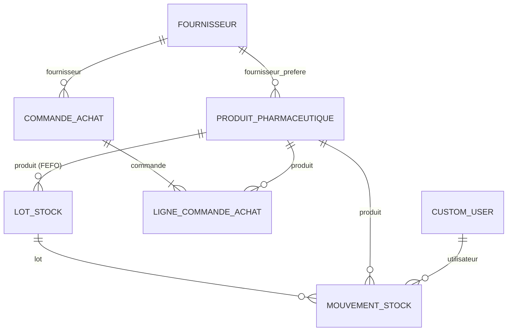

# Spécification Technique & Fonctionnelle — Module Gestion de Stock Pharmaceutique et d'Achats

**Application** : SIH Clinique Sidi Yahia 2 (`apps/pharmacie`)  
**Conformité** : HDS / RGPD / Traçabilité Sanitaire des Lots (FEFO) & Registre des Stupéfiants

---

## 1. Schéma de Base de Données (SQL / Django ORM)



### Équivalent SQL (PostgreSQL / HDS)
```sql
CREATE TABLE pharmacie_fournisseur (
    id BIGSERIAL PRIMARY KEY,
    nom VARCHAR(150) UNIQUE NOT NULL,
    contact VARCHAR(120) NOT NULL DEFAULT '',
    email VARCHAR(254) NOT NULL DEFAULT '',
    telephone VARCHAR(30) NOT NULL DEFAULT '',
    delai_livraison_moyen INTEGER NOT NULL DEFAULT 1 CHECK (delai_livraison_moyen >= 0),
    conditions_paiement VARCHAR(120) NOT NULL DEFAULT '30 jours fin de mois',
    est_actif BOOLEAN NOT NULL DEFAULT TRUE,
    created_at TIMESTAMPTZ NOT NULL DEFAULT NOW(),
    updated_at TIMESTAMPTZ NOT NULL DEFAULT NOW()
);

CREATE TABLE pharmacie_produitpharmaceutique (
    id BIGSERIAL PRIMARY KEY,
    code_cip_ean13 VARCHAR(20) UNIQUE NOT NULL,
    dci VARCHAR(200) NOT NULL,
    nom_commercial VARCHAR(200) NOT NULL,
    dosage VARCHAR(100) NOT NULL,
    forme_galenique VARCHAR(100) NOT NULL,
    classe_therapeutique VARCHAR(150) NOT NULL DEFAULT '',
    categorie VARCHAR(40) NOT NULL DEFAULT 'MEDICAMENT_REMBOURSABLE',
    fournisseur_prefere_id BIGINT REFERENCES pharmacie_fournisseur(id) ON DELETE SET NULL,
    prix_achat_ht NUMERIC(10, 2) NOT NULL DEFAULT 0.00,
    prix_moyen_pondere_ht NUMERIC(10, 2) NOT NULL DEFAULT 0.00,
    taux_tva NUMERIC(5, 2) NOT NULL DEFAULT 2.10,
    prix_vente_ttc NUMERIC(10, 2) NOT NULL DEFAULT 0.00,
    stock_minimum INTEGER NOT NULL DEFAULT 20,
    stock_securite INTEGER NOT NULL DEFAULT 10,
    stock_maximum INTEGER NOT NULL DEFAULT 100,
    methode_rotation VARCHAR(10) NOT NULL DEFAULT 'FEFO',
    rayon_par_defaut VARCHAR(100) NOT NULL DEFAULT 'Armoire Pharmacie Centrale - A1',
    created_at TIMESTAMPTZ NOT NULL DEFAULT NOW(),
    updated_at TIMESTAMPTZ NOT NULL DEFAULT NOW()
);

CREATE TABLE pharmacie_lotstock (
    id BIGSERIAL PRIMARY KEY,
    produit_id BIGINT NOT NULL REFERENCES pharmacie_produitpharmaceutique(id) ON DELETE CASCADE,
    numero_lot VARCHAR(80) NOT NULL,
    date_peremption DATE NOT NULL,
    quantite_disponible INTEGER NOT NULL DEFAULT 0 CHECK (quantite_disponible >= 0),
    emplacement_physique VARCHAR(120) NOT NULL,
    statut VARCHAR(25) NOT NULL DEFAULT 'ACTIF',
    motif_quarantaine_rappel VARCHAR(255) NOT NULL DEFAULT '',
    created_at TIMESTAMPTZ NOT NULL DEFAULT NOW(),
    updated_at TIMESTAMPTZ NOT NULL DEFAULT NOW(),
    UNIQUE (produit_id, numero_lot)
);
CREATE INDEX idx_lotstock_fefo ON pharmacie_lotstock (produit_id, date_peremption ASC, id ASC);

CREATE TABLE pharmacie_commandeachat (
    id BIGSERIAL PRIMARY KEY,
    numero_commande VARCHAR(50) UNIQUE NOT NULL,
    fournisseur_id BIGINT NOT NULL REFERENCES pharmacie_fournisseur(id) ON DELETE PROTECT,
    date_creation TIMESTAMPTZ NOT NULL DEFAULT NOW(),
    date_livraison_prevue DATE,
    statut VARCHAR(25) NOT NULL DEFAULT 'BROUILLON',
    montant_total_ht NUMERIC(12, 2) NOT NULL DEFAULT 0.00,
    montant_total_ttc NUMERIC(12, 2) NOT NULL DEFAULT 0.00,
    cree_par_id BIGINT REFERENCES core_customuser(id) ON DELETE SET NULL,
    notes TEXT NOT NULL DEFAULT '',
    created_at TIMESTAMPTZ NOT NULL DEFAULT NOW(),
    updated_at TIMESTAMPTZ NOT NULL DEFAULT NOW()
);

CREATE TABLE pharmacie_lignecommandeachat (
    id BIGSERIAL PRIMARY KEY,
    commande_id BIGINT NOT NULL REFERENCES pharmacie_commandeachat(id) ON DELETE CASCADE,
    produit_id BIGINT NOT NULL REFERENCES pharmacie_produitpharmaceutique(id) ON DELETE PROTECT,
    quantite_commandee INTEGER NOT NULL CHECK (quantite_commandee >= 1),
    quantite_recue INTEGER NOT NULL DEFAULT 0 CHECK (quantite_recue >= 0),
    prix_unitaire_achat_negocie NUMERIC(10, 2) NOT NULL
);

CREATE TABLE pharmacie_mouvementstock (
    id BIGSERIAL PRIMARY KEY,
    lot_id BIGINT NOT NULL REFERENCES pharmacie_lotstock(id) ON DELETE PROTECT,
    produit_id BIGINT NOT NULL REFERENCES pharmacie_produitpharmaceutique(id) ON DELETE PROTECT,
    type_mouvement VARCHAR(30) NOT NULL,
    quantite INTEGER NOT NULL,
    stock_lot_avant INTEGER NOT NULL,
    stock_lot_apres INTEGER NOT NULL,
    date_mouvement TIMESTAMPTZ NOT NULL DEFAULT NOW(),
    utilisateur_id BIGINT REFERENCES core_customuser(id) ON DELETE PROTECT,
    motif_reference VARCHAR(255) NOT NULL
);
```

---

## 2. Architecture des Routes & Services Transactionnels

| Méthode & Route | Vue / Service | Garantie Transactionnelle & Métier |
| :--- | :--- | :--- |
| `GET /pharmacie/` | `PharmacieDashboardView` | Calcul temps réel des 4 KPIs, catalogue filtrable FEFO, suggestions `(Stock Max - Stock Actuel)`, réceptions et audit. |
| `POST /pharmacie/fefo-dispense/` | `dispensation_sortie_fefo()` | `@transaction.atomic` + `select_for_update()` sur `LotStock` trié par `date_peremption ASC`. Prélève d'abord le lot expirant le plus tôt. |
| `POST /pharmacie/lot/<id>/quarantine/` | `mettre_lot_en_quarantaine_ou_rappel()` | Isole un lot (`QUARANTAINE`, `RAPPELE`, `PERIME`) et journalise le retrait dans `MouvementStock`. |
| `POST /pharmacie/orders/create/` | `creer_commande_achat_depuis_lignes()` | Génère un Bon de Commande (`BC-PHARM-...`) à partir des suggestions automatiques `(Stock Max - Stock Actuel)`. |
| `POST /pharmacie/orders/<id>/receive/` | `receptionner_livraison_commande()` | Exige obligatoirement **N° de lot + Date de péremption**, gère les reliquats partiels et recalcule le **Prix Moyen Pondéré (PMP)**. |
| `POST /pharmacie/inventory/adjust/` | `ajuster_inventaire_tournant()` | Corrige l'écart entre stock théorique et stock réel avec **justification écrite obligatoire** et trace immuable. |
| `GET /pharmacie/api/barcode/<code>/` | `api_scan_code_barres()` | Endpoint JSON ultra-rapide pour douchette code-barres CIP13 / EAN13. |

